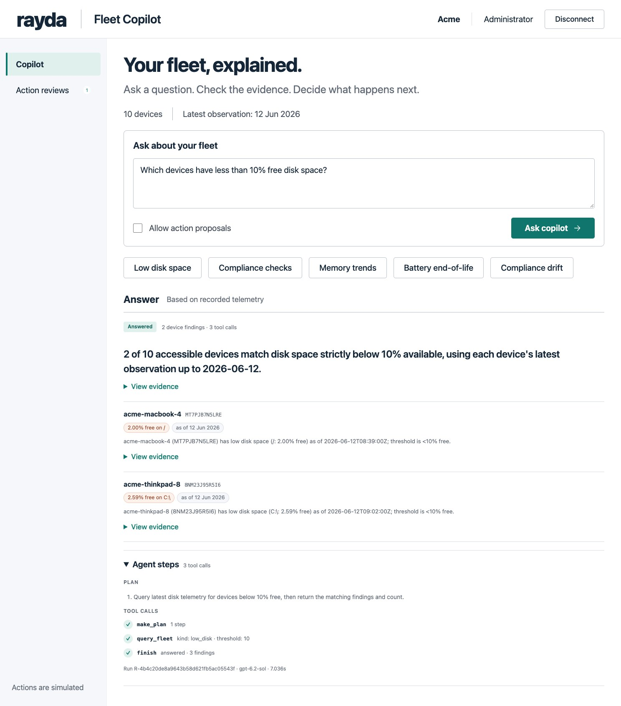
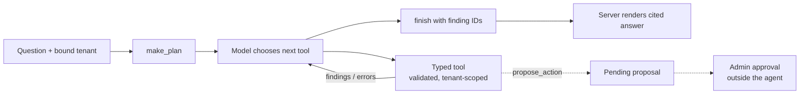

# Rayda Fleet Copilot

A LangGraph agent that answers fleet health and compliance questions from device telemetry, detects trends over time, and proposes actions for IT administrators. Every answer cites source evidence, and every action needs an administrator's approval. Approved actions are **simulated**: nothing is sent, ordered or changed on a real device.

**Live demo:** [fleet-demo.dexspaceltd.com](https://fleet-demo.dexspaceltd.com/). An access token is provided separately; paste it into the connection screen.

> **Note:** This repository is public only so Rayda's reviewers can access the take-home assessment. It includes the assessment dataset supplied by Rayda, and it will be made private again after the review.



For the full detail behind each section below, see the **[technical guide](docs/technical-guide.md)**.

## Try it in five minutes

1. Open the demo, or run it locally (below) with `uv run fleet ui`.
2. Click **Low disk space**, then **Ask copilot**. Two Acme devices are below 10% free disk. Expand **View evidence** to see the source lines, timestamps and formulas.
3. Try **Battery end-of-life** or **Memory trends**. Under each answer, **Agent steps** shows the plan and every tool call with its arguments, including any call the server rejected and the model then corrected.
4. Turn on **Allow action proposals** and ask: `Check acme-macbook-4 for low disk space and propose one remediation ticket if justified.` Open **Action reviews**, inspect the evidence, then approve or reject.
5. Run the evaluation suite (below).

## Installation and setup

Requires Python 3.11–3.14 and [uv](https://docs.astral.sh/uv/getting-started/installation/).

```sh
git clone https://github.com/viktority/rayda-fleet-copilot.git
cd rayda-fleet-copilot
uv sync --frozen
uv run fleet init        # validates and loads the 750 snapshots into local SQLite
```

The original dataset is in [`data/raw/`](data/raw/). It covers **14 May to 12 June 2026**; see the [dataset inspection](reports/dataset-inspection.md) for schema and limitations. Tests, offline evaluation and deterministic queries need no API key. For natural-language questions, copy `.env.example` to `.env.local` and set `OPENAI_API_KEY`. The key stays on the server.

## Running the agent

```sh
uv run fleet ui                     # browser UI + API at http://127.0.0.1:8000
uv run fleet ask --company acme-001 'Which devices at Acme are low on disk space?'
uv run fleet ask --company acme-001 'Show laptops failing high-severity compliance checks.'
```

The second question should correctly find **no** matches and say so, with evidence for the devices it checked.

Action proposals and approval from the CLI:

```sh
uv run fleet ask --company acme-001 --propose \
  'Check acme-macbook-4 for low disk space and propose one remediation ticket if justified.'
uv run fleet proposals --company acme-001
uv run fleet decide --company acme-001 --actor reviewer --role admin \
  PROPOSAL_ID --digest REVIEWED_DIGEST --approve --confirm
uv run fleet audit --company acme-001 --role admin
```

There is also an authenticated HTTP API (`uv run fleet serve`). Its endpoints and token setup are in the [technical guide](docs/technical-guide.md#http-api).

## Running evaluations

```sh
uv run pytest                                               # 42 tests
uv run fleet eval --output runtime/evaluation-offline.json  # 21 cases, deterministic, no key
uv run fleet eval --live --output runtime/evaluation-live.json  # same 21 cases against the real model
```

- **Offline** replaces the model with a scripted router that makes the correct tool calls. Everything else is real: the LangGraph loop, tools, citation checks and action policy. It's deterministic and runs in CI.
- **Live** sends the questions to the configured model. It checks the expected devices and counts, refusals, tenant isolation, that citations resolve, and that no action runs without approval.

The cases cover each tenant's queries, empty-result traps, version and persistence calculations, battery end-of-life risk, compliance drift, a cross-tenant request, a prompt-injection attempt, refusals of unsupported predictions and unknown policy, all three action types, and an action refused for lack of evidence. Saved results: [offline 21/21](reports/evaluation-offline.json), [live 21/21](reports/evaluation-live.json). This is a small regression corpus, not a reliability estimate.

## Agent architecture



An explicit LangGraph loop runs between a `model` node and a `tools` node:

- The model must record a plan first. After that it makes one tool call per step and decides the next one from the result, up to a 12-step budget.
- Tool errors go back to the model as observations it can recover from.
- The tenant is fixed before the graph starts, so the model never chooses which company's data to read.
- Approval is deliberately outside the graph. It is a durable, admin-only state machine the model can't call.

## Tool catalog

| Tool | Purpose |
| --- | --- |
| `make_plan` | Records a short operational plan before any other tool |
| `query_fleet` | Current state: inventory, low disk, high RAM, failed compliance, older macOS, battery service condition, installed software |
| `analyze_trends` | History: persistent RAM/disk pressure, battery end-of-life risk and capacity changes, compliance and software drift |
| `propose_action` | Creates a pending, simulated `open_remediation_ticket`, `notify_employee` or `flag_device_for_replacement`, only when the cited findings qualify |
| `finish` | Picks which findings answer the question, or a refusal reason |

`create_upgrade_order` is **refused**: the data has no hardware compatibility or purchasing catalog, so no specification could be justified by evidence. The model has no SQL, shell or network access.

## Grounding strategy

- Tools return **findings**, each with a deterministic ID, computed values, the method used, and evidence: source file hash, line number, device and timestamp.
- The model only chooses which finding IDs to report. The server writes the final answer from those findings, so the model can't invent numbers or citations, and IDs that were never returned are rejected.
- Empty results are still answered, with evidence for the devices that were checked.
- Thresholds are explicit: low disk is <10% free; high RAM is >85% used; "persistent" means on ≥80% of days, with at least 7 days observed.
- Batteries approaching end-of-life are flagged only when at least 2 of 3 signals agree: a Service Recommended condition, a ≥2% capacity decline over the window, and ≥1,000 cycles. Three Acme devices qualify.
- Unsupported conclusions are refused rather than estimated. Examples: an exact battery failure date, or calling software "forbidden" without a policy.

## Guardrails

| Requirement | How it's enforced |
| --- | --- |
| Tenant isolation | Principal bound outside the model; every query filtered by company; other tenants' IDs look identical to missing ones |
| Human approval | Separate admin-only decision with explicit confirmation and the exact payload digest. Proposals expire after 24h and are tied to the dataset version |
| Evidence for actions | Each action type needs specific qualifying findings, re-checked when the proposal is created |
| Audit log | Plans, tool calls, proposals and decisions persisted in an append-only audit table |
| Safe effects | Approved actions are recorded as simulations only. Repeated or concurrent approvals produce one effect |

Each row has tests, including colliding device IDs across tenants, fabricated citations, stale digests and concurrent approvals.

## Key design decisions and trade-offs

- **SQL analytics over retrieval.** 750 structured snapshots call for exact formulas, not a vector database.
- **Server-written answers.** Every number is traceable, at the cost of less fluent prose. The model still plans, picks tools and adapts.
- **Approval outside the graph.** A durable state machine instead of a LangGraph interrupt keeps the role boundary explicit and survives restarts.
- **Refuse rather than guess.** Upgrade orders and exact battery-life predictions are declined because the data can't support them. End-of-life *risk* is reported from corroborating signals instead.
- **Not production yet.** That would need real identity management, monitoring, backups and reviewed integrations with action providers.

More detail, including the HTTP API, the full policy, all test coverage and troubleshooting, is in the [technical guide](docs/technical-guide.md).

## Repository layout

```text
src/fleet_copilot/   agent, tools, analytics, actions, storage, API, CLI, evaluation
src/fleet_copilot/web/  browser UI (plain HTML/CSS/JS, no build step)
tests/               isolation, grounding, approval, API and graph tests
data/raw/            original dataset
reports/             dataset inspection and saved evaluation reports
docs/                technical guide and screenshots
```
