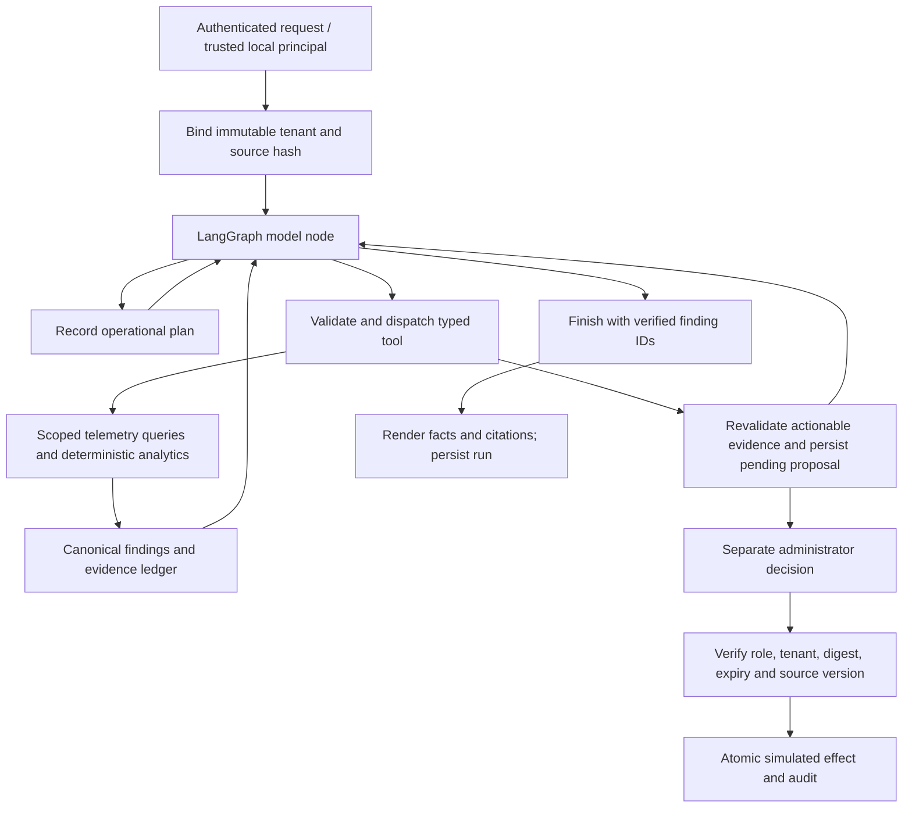

# Rayda Fleet Copilot

A runnable LangGraph agent for the supplied fleet telemetry assessment. It answers natural-language questions with verifiable snapshot evidence, detects historical patterns, and proposes justified actions. Administrative approval records a **simulated** effect; it never sends messages, places orders, or modifies a real device.

**Deployed demo:** [fleet-demo.dexspaceltd.com](https://fleet-demo.dexspaceltd.com/). A Fleet access token is supplied separately to reviewers. Paste that token into the connection screen; never enter an OpenAI API key there. The demo opens an Acme-scoped administrator session for reviewing simulated actions.


## Reviewer guide

1. Open the demo, or follow the local setup below and run `uv run fleet ui`.
2. Select **Low disk space**, then **Ask copilot**. The supplied Acme data has two devices with less than 10% available disk space. Expand **View evidence** to inspect source lines, timestamps and calculation methods.
3. Try **Memory trends** to inspect repeated constraints over the observation window. **Agent steps** shows the operational plan and tool calls.
4. Enable **Allow action proposals** and ask: `Check acme-macbook-4 for low disk space and propose one remediation ticket if justified.` Open **Action reviews**, inspect the evidence, and choose **Approve simulation** or **Reject**. A second confirmation protects the decision.
5. Run the tests and offline evaluations below. Live model evaluations are optional and incur provider usage.

This repository contains the original dataset, source, locked dependencies, tests, evaluation corpus and saved reports. The frontend needs no Node installation or build step. All fleet facts refer to historical assessment telemetry, not a live device connection.

## Quick start

Use Git, Python 3.11-3.14 (3.12 is used in CI), and [uv](https://docs.astral.sh/uv/getting-started/installation/). Repository access is required while this submission is private. Commands below run from the cloned repository root.

```sh
git clone https://github.com/viktority/rayda-fleet-copilot.git
cd rayda-fleet-copilot
uv sync --frozen
uv run fleet init
uv run pytest
uv run fleet eval --output runtime/evaluation-offline.json
```

These commands work without an OpenAI key. The original dataset is included in [`data/raw/`](data/raw/). Ingestion validates all 750 snapshots and is transactional and idempotent. The observation window is **14 May to 12 June 2026**, not today's live fleet state. See the [dataset inspection](reports/dataset-inspection.md) for schema, provenance, checksums and data limitations.

For natural-language questions, create the local configuration without replacing an existing file:

```sh
cp -n .env.example .env.local
chmod 600 .env.local
```

Edit `.env.local` in your editor and set `OPENAI_API_KEY` to your own key. Alternatively, supply it through your environment or secret manager. The default model is `gpt-6.2-sol`; set `OPENAI_MODEL` to a tool-calling Responses API model available to your project if necessary. Model access and billing are provider prerequisites, and model changes can change evaluation outcomes. Credentials are never included in this repository. Do not paste a key into a README, issue, screenshot, or shell-history command.

Start the browser interface:

```sh
uv run fleet ui
```

For the CLI instead:

```sh
uv run fleet ask --company acme-001 \
  'Which devices at Acme are low on disk space?'

uv run fleet ask --company acme-001 --json \
  'Which devices consistently use more than 85% RAM on at least 80% of days?'

uv run fleet ask --company acme-001 \
  'Show laptops failing high-severity compliance checks.'
```

The last example should report no matching failures, with evidence for the scanned population. It must not invent a problem because the question implies one exists.

For credential-free deterministic inspection:

```sh
uv run fleet query --company acme-001 '{"kind":"low_disk"}'
uv run fleet trends --company acme-001 '{"kind":"ram"}'
```

The CLI is a **trusted local operator interface**: its company and role flags select a principal for local use. They are not an authentication system for remote users. The HTTP interface derives those values exclusively from server-configured credentials.

## Browser interface

For the easiest local experience:

```sh
uv run fleet ui
```

This starts the frontend and API together on `http://127.0.0.1:8000` and opens a connected browser tab. Use the example buttons or type a question, expand **View evidence**, and open **Action reviews** to inspect proposals. **Approve simulation** and **Reject** each show the exact payload and require a separate confirmation. All effects remain simulated.

The launcher binds a single trusted local principal (Acme administrator by default). To inspect a different company or access level, start a separate instance:

```sh
uv run fleet ui --company globex-002 --role viewer --port 8001
```

There is no company or role override in the browser. Like the CLI, this launcher is for the trusted local operator; it is not a public login system. It generates an ephemeral Fleet bearer credential, writes the connection URL to `runtime/ui-access-PORT.json` with owner-only permissions, and opens it in the browser. The URL fragment is removed immediately and the Fleet credential is kept in that tab's session storage. **The OpenAI key never enters the frontend.** The access file is removed on normal shutdown; restarting rotates the credential. Disconnect clears the browser tab's stored credential and visible data. `--no-open` starts the service without launching a browser.

The existing `fleet serve` command also serves this interface at `/`; connect using a configured Fleet bearer token. Static HTML/CSS/JavaScript are included in the Python package, so no Node installation or frontend build step is needed. The interface supports loading, empty results, errors, expired proposals, and narrow mobile layouts.

## A complete action workflow

```sh
uv run fleet ask --company acme-001 --propose --json \
  'Check acme-macbook-4 for low disk space and propose one remediation ticket if justified.'

uv run fleet proposals --company acme-001
```

Review the returned action, target, canonical evidence, simulation scope, expiry and digest. Then use the proposal ID and digest from that exact payload:

```sh
uv run fleet decide --company acme-001 --actor reviewer --role admin \
  PROPOSAL_ID --digest REVIEWED_DIGEST --approve --confirm

uv run fleet audit --company acme-001 --role admin
```

Use `--reject --confirm` instead to reject. The model never receives the `decide` operation. An operator can propose; only an administrator can approve or reject. `--propose` enables proposals for that request and does not authorize execution.

Proposal state and audit history survive process restarts in `runtime/fleet.sqlite3`. A repeated matching decision returns the same recorded effect. Concurrent approvals are serialized by a SQLite transaction and a unique effect key. A changed review digest, expired proposal, changed dataset, wrong tenant, wrong role, or conflicting prior decision prevents execution. Proposals expire after 24 hours; ask again for a fresh proposal. Repeated calls with the same run/action/device/evidence deduplicate; separate intentional runs can create separate proposals.

## Authenticated HTTP API

Set `FLEET_API_TOKENS` in the environment to a JSON object mapping **independent, random bearer tokens of at least 32 characters** to trusted principals:

```json
{
  "<random-operator-token>": {"company_id":"acme-001","actor_id":"it-operator","role":"operator"},
  "<different-random-admin-token>": {"company_id":"acme-001","actor_id":"it-admin","role":"admin"}
}
```

These are illustrative placeholders, not usable credentials. Generate tokens locally with a cryptographic random generator; do not reuse the OpenAI API key. The API refuses to start with no token bindings or short tokens. Run:

```sh
uv run fleet serve --port 8000
```

Open `http://127.0.0.1:8000/docs` for interactive API documentation. Authenticate with the appropriate bearer credential.

| Method | Path | Purpose |
| --- | --- | --- |
| GET | `/health` | Readiness and simulation mode; no tenant data |
| GET | `/v1/context` | Company, role, device count and observation date derived from the bearer credential |
| POST | `/v1/ask` | `{"question":"...","allow_proposals":false}` |
| GET | `/v1/runs/{id}` | Tenant-scoped saved answer, evidence and execution trace |
| GET | `/v1/proposals` | Tenant-scoped review queue |
| GET | `/v1/proposals/{id}` | Immutable proposed payload and review digest |
| POST | `/v1/proposals/{id}/decision` | Admin-only `decision`, `expected_digest`, `confirmed:true` |
| GET | `/v1/audit` | Administrator view of that company's audit events |

Requests cannot supply a company or role override. Unknown and inaccessible device/run/proposal IDs return equivalent not-found responses. No CORS or unauthenticated development bypass is enabled. This is an assessment prototype with bearer-token access, not a production identity system. Production use would require managed user identity, token lifecycle management, quotas, operational monitoring, backups, and reviewed integrations with real action providers.

## Agent architecture



The model chooses tools, filters and subsequent steps based on tool results. The graph loops until a valid finish or a 12-step budget. Tool errors become structured observations the model can recover from. Invalid tool names, schemas, unauthorized calls and fabricated citations cannot escape into executable operations or factual final prose. There is no arbitrary SQL, shell, network, or execution tool exposed to the model.

Planning is a short observable sequence of intended operations, not a private chain-of-thought transcript. The response includes the plan, tool trace, model name, usage, dataset hash, elapsed time, findings and proposals.

Approval uses an application-owned durable state machine rather than keeping a model process suspended in a LangGraph interrupt. This makes the exact reviewed payload and role boundary explicit, survives restarts, and permits atomic local effect recording. The reasoning graph is request-scoped; this version does not promise multi-turn conversational memory or checkpoint recovery for a failed model request. Pending proposals remain accessible if a later model request fails.

## Tool catalog

| Tool | Behavior |
| --- | --- |
| `make_plan` | Record up to six operational steps, once at the start |
| `query_fleet` | Latest inventory, disk, RAM, failed compliance, macOS major-version comparison, service-condition batteries, exact software presence; optional device/date/platform/laptop-or-desktop filters |
| `analyze_trends` | Persistent disk/RAM, capacity changes and battery anomalies, before/after compliance and software drift |
| `propose_action` | Validate canonical findings and create a pending simulated ticket, replacement-review flag, or employee notification |
| `finish` | Select existing finding IDs and a supported answer/refusal status; server renders the final facts |

`create_upgrade_order` is explicitly refused because no trusted hardware compatibility or purchasing catalog is supplied. Pretending an arbitrary component specification was justified would undermine the assessment's evidence requirement.

For `open_remediation_ticket` and `notify_employee`, qualifying findings are a current low-disk result, a failed compliance check, a reported battery service condition, or persistent RAM utilization under the default policy. Notification recipients come from device ownership in telemetry; arbitrary contact addresses or model-written messages are not accepted. `flag_device_for_replacement` means **assessment only** and requires both persistent RAM utilization and a battery service condition. This conservative, documented rule is a demo policy assumption, not a Rayda policy or a purchasing decision.

## Grounding and policy

Every finding has a deterministic ID, server-authored factual text, computed values, calculation method, and evidence containing source SHA-256, line number, company ID, device ID, timestamp and relevant field paths. Full evidence stays in the server ledger; compact findings go to the model. Final prose uses canonical findings, preventing invented numbers or fabricated citation text. Selection relevance still depends on model routing and is measured separately in live evaluations.

Empty results include evidence for the scanned population. Counts use unique devices' latest snapshots, not the number of observations. Historical queries use their requested as-of date. Source bytes remain unchanged; ingestion stores a validated normalized representation. Replacing the source invalidates pending approvals conservatively, even for a change in another tenant.

Default policy assumptions:

- Low disk: strictly less than 10% available on a volume.
- High RAM: strictly greater than 85% used.
- Persistent: threshold met on at least 80% of days in the requested window (or the selected population's observed span when no dates are supplied), with at least seven observed days. Same-day samples count once; missing dates count against the denominator. Disk persistence is tracked per mount point.
- Battery health percentage and remaining life are unsupported without design capacity and an adequate model. Cycle-count decreases are surfaced rather than corrected.
- Software presence is not proof of unauthorized use, malware or a policy violation.
- Current-action eligibility uses the documented default policy and latest available dataset evidence. Custom-threshold explorations cannot silently weaken action guards.

Policy parameters can be set explicitly for analytical queries. They are visible in finding metadata. Human administrators must interpret historical evidence appropriately before any real deployment; all adapters in this submission are simulated.

## Evaluation and verification

```sh
uv run pytest
uv run ruff check src tests
uv run ruff format --check src tests
uv run fleet eval --output runtime/evaluation-offline.json
uv run fleet eval --live --output runtime/evaluation-live.json
```

Verified during development: **39 tests passing**, **14/14 offline cases**, and **14/14 live cases** using the recorded model configuration. See the saved [offline report](reports/evaluation-offline.json), [live report](reports/evaluation-live.json), and [browser verification](docs/design/frontend-qa.md). These are observed results, not guarantees of future model behavior. New runs write to ignored `runtime/` paths so the original report evidence stays intact. GitHub Actions runs lint, formatting, tests and the offline corpus on pushes and pull requests; no provider key is required in CI.

Offline evaluation uses a **routing oracle** to exercise the actual LangGraph loop, tools, citations and proposal policy on a fixed 14-case corpus. It is deterministic and needs no provider key. It does not measure natural-language understanding. Live evaluation sends the same questions to the configured OpenAI model, then checks expected device sets/counts, status, tenant isolation, citation resolution, canonical answer rendering, proposal counts and the absence of effects without approval. Live evaluation incurs API usage and is not perfectly deterministic.

The test suite also covers historical vs latest counts, threshold boundaries, missing telemetry, version filtering, data-ingestion rollback, deliberately colliding tenant/device IDs, fabricated citations, unexposed execution tools, authenticated API boundaries, missing compatibility data, stale/expired proposals, digest mismatch, rejection, restarts and concurrent approval idempotency. Synthetic edge-case fixtures are created in temporary test directories; the original dataset is preserved.

Reports include individual assertions, responses, source version, model and usage. These are small regression corpora, not estimates of production reliability. Larger paraphrase/adversarial suites, more tenants and representative operational data would be needed before production claims.

## Guardrails

| Boundary | Enforcement | Verification |
| --- | --- | --- |
| Tenant isolation | Immutable principal bound outside the model; database and evidence lookups scoped by company | Cross-tenant API, tool, run and proposal tests, including colliding device IDs |
| Evidence | Only canonical finding IDs can appear in final facts or justify proposals | Fabricated citations, empty populations, source-line resolution and numerical assertions |
| Approval | Separate administrator endpoint with explicit confirmation, digest, expiry and source-version checks | Rejection, unauthorized role, stale payload, expiry and data-change cases |
| Effect safety | Simulation-only adapters; no execution tool exposed to the model | No effect before approval, restart durability and concurrent idempotency tests |
| Untrusted content | Typed tool schemas; telemetry and prompts cannot alter principal, policy or allowed operations | Invalid tools, schema failures and adversarial requests |
| Traceability | Persisted plans, tool calls, source hashes, proposals, decisions and append-only audit events | Saved run/audit retrieval and audit mutation tests |

## Assessment deliverables

| Requirement | Where to review |
| --- | --- |
| Git repository and runnable source | This repository; [`src/fleet_copilot/`](src/fleet_copilot/) |
| Installation, setup and running the agent | [Quick start](#quick-start), [browser interface](#browser-interface), [HTTP API](#authenticated-http-api) |
| Runnable evaluation suite and deterministic execution | [Evaluation and verification](#evaluation-and-verification), [`evaluation.py`](src/fleet_copilot/evaluation.py), [`tests/`](tests/), `uv.lock` |
| Planning, tool calls and explicit agent loop | [Agent architecture](#agent-architecture), [`agent.py`](src/fleet_copilot/agent.py) |
| Tool catalog | [Tool catalog](#tool-catalog), typed schemas in [`analytics.py`](src/fleet_copilot/analytics.py) and [`actions.py`](src/fleet_copilot/actions.py) |
| Grounded Q&A, trends, evidence and explanations | [Grounding and policy](#grounding-and-policy), source-linked findings in CLI/API/browser |
| Justified action proposals, human approval and audit | [Complete action workflow](#a-complete-action-workflow), [guardrails](#guardrails) |
| Key decisions and trade-offs | [Design choices and limits](#design-choices-and-limits) |

The assessment's action names are examples. This implementation supports three guarded proposal types and explicitly refuses upgrade orders without compatibility/purchasing evidence. It also refuses a battery end-of-life estimate when design capacity or a valid remaining-life model is absent. Those limits are intentional evidence boundaries.

## Troubleshooting

- **Missing key / provider error:** check the ignored `.env.local` file, project billing and model access. Offline tests and deterministic queries remain available without a key. Provider details are deliberately sanitized in user-facing errors.
- **Port already in use:** use `uv run fleet ui --port 8001`. A second launcher cannot replace the first launcher's session file.
- **Connection expired or invalid:** restart `fleet ui` to open a fresh local session, or obtain a fresh demo access token. Fleet credentials and OpenAI credentials serve different purposes.
- **No matching devices:** inspect the scanned-population evidence and the requested company/date. Empty results are valid; for example, the provided latest laptop records contain no high-severity compliance failures.
- **Proposal expired or changed:** ask for a fresh proposal and review its new digest. Proposals are valid for 24 hours and are tied to the exact dataset version.
- **A question takes too long:** the browser bounds waiting and reports failures. If a request was submitted, check **Action reviews** before retrying a proposal, because server work may finish after a browser disconnect.

## Design choices and limits

- **Structured analytics, no vector database:** 750 well-structured snapshots fit easily in SQLite. Numerical comparisons and window calculations benefit from explicit formulas. A retrieval index would add complexity without improving this dataset's core tasks.
- **Scoped queries, no model-controlled tenant:** a trusted principal is bound outside the graph; every database operation filters by company. A conservative known-company prompt check adds an early refusal but is not the authorization mechanism.
- **Canonical final facts:** stronger numeric traceability at the cost of less fluent free-form explanations. The model still performs planning, tool selection and adaptation.
- **Application-enforced approval:** evidence revalidation and immutable digests protect the review boundary. SQLite transactions give one local effect per approved proposal. Real external actions would need an outbox, provider idempotency and reconciliation; this code makes no external exactly-once claim.
- **Append-only audit API:** update/delete triggers prevent accidental application mutation. This is not tamper-proof storage against an administrator who controls the SQLite file.
- **Bounded model use:** at most 12 tool steps, one call at a time, a 2,500-token output cap per response, request timeouts and one provider retry. Credentials, raw provider errors and complete prompts are not written to audit records. SDK calls use `store=False`; that setting is not a claim of zero provider retention.
- **Reproducibility:** committed dependency lock, explicit policies, source checksum and deterministic offline runs. The configured model name is recorded; a floating model name and provider behavior can change live results.

## Layout

```text
src/fleet_copilot/  domain, persistence, analytics, actions, graph, provider, API, CLI, evaluation
src/fleet_copilot/web/  buildless HTML/CSS/JavaScript frontend
tests/             regression, isolation, approval, HTTP and graph tests
data/raw/          original assessment dataset
reports/           inspection and evaluation evidence
scripts/           reproducible dataset profiling
docs/design/       UI reference, screenshots and browser verification
runtime/           ignored local SQLite state
```

Implementation references: [LangGraph graph loop](https://docs.langchain.com/oss/python/langgraph/quickstart), [LangGraph durable interrupts](https://docs.langchain.com/oss/python/langgraph/interrupts), [OpenAI function calling](https://developers.openai.com/api/docs/guides/function-calling), and [OpenAI model changelog](https://developers.openai.com/api/docs/changelog).
